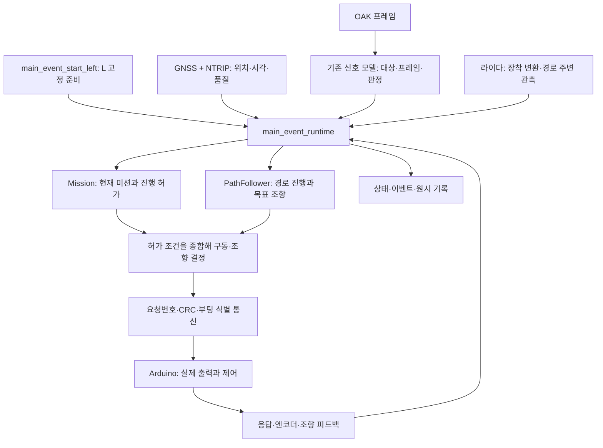

# 입력이 차량 명령이 되기까지

최종 시스템은 Python 프로세스들과 Arduino 제어 보드의 조합이다. 초기 계획의 ROS2 노드 전체를 완성한 구조로 설명하면 실제 구현과 다르다. HYPER의 경로·미션·신호 모델을 재사용하고, 우리 차량의 보정·통신·추종·미션 실행에 연결했다.



## 1. 준비와 출발은 서로 다른 상태다

`main_event_start_left.py`의 `prepare_left()`는 제출본 검증과 이전 세션 상태 확인 후 L 차선으로 준비를 요청한다. 이후 현재 heartbeat와 `ready`, `phase`를 읽는다. 명시적 키2 입력 때 다시 신선한 READY를 확인한 뒤 출발을 요청한다.

준비 상태에서 출력0을 유지했다는 사실은 경사로·신호·S 등 주행 중 모든 전환이 성공했다는 뜻이 아니다. 실제로 정지 READY 유지 검사 이후에도 본선 첫 신호 대기 중 별도 복구 잠금이 발생했다. **상태 하나가 성공한 것과 전체 동작이 성공한 것을 구분하는 것**이 이 사례의 핵심이다.

## 2. GPS 위치만으로 조향할 수 없는 이유

경로 추종은 차량 위치 `(x, y)`와 차량이 향하는 방향 `yaw`, 경로의 진행 방향을 함께 사용한다. 한 위치 점만으로 정지 차량의 앞쪽 방향을 결정할 수 없다. 기존 구현은 초기 전진과 연속 위치 차이를 이용하는 heading 취득, 안테나와 차체 기준점 차이, 경로 진입 조건을 다룬다.

RTK FIX는 위치 해의 품질이다. NTRIP 인터넷 연결, 보정 수신, FIX, 실행기가 읽은 위치의 신선도, heading의 유효성은 각각 다르다. 저장 로그에서 FIX가 계속 보인다고 실행기에서 한 번도 오래된 위치를 읽지 않았다고 단정할 수 없다.

## 3. Pure Pursuit의 계산

`path_steering.compute_target()`는 앞쪽 경로에서 lookahead 목표점 `(gx, gy)`를 고른다. 실제 목표점까지 거리 `ld`, 차체 방향과 목표 방향의 차이 `alpha`, 축간거리 `L`로 다음을 계산한다.

```text
alpha = wrap(atan2(gy - y, gx - x) - yaw)
곡률 kappa = 2 * sin(alpha) / ld            [1/m]
등가 조향각 delta = atan(L * kappa)        [rad]
```

lookahead는 바로 옆의 경로점만 쫓지 않고 앞의 목표점을 향하게 한다. 커지면 같은 옆쪽 편차에서 곡률이 작아질 수 있지만, 좁은 곡선에서 경로를 잘라 갈 수도 있다. 따라서 “크면 항상 부드럽고 좋다”가 아니다. 실제 코드에는 위치 신선도·횡오차·방향오차·종점·측정 조향 한계 판단도 있다. 경로에서 멀리 떨어진 모든 자세를 자동으로 복구하는 범용 제어기는 아니다.

차량의 좌우 조향 한계가 다르면 같은 반경의 좌회전/우회전이 동일하게 가능하지 않다. 당시 DIR50·직진 ADC477·좌25°/우19°는 해당 차량의 기록이다. 다른 차량에 복사할 기본값으로 사용하지 않는다.

## 4. 목표와 실제 출력은 다르다

추종기가 만든 각도는 조향 보정과 보드 통신을 거쳐 실제 제어로 이어진다. PWM100은 모터 명령값이며 100m/s나 일정 속도 보장이 아니다. `선택 PWM`, `전송 PWM`, 엔코더/위치로 관측한 움직임을 구분해야 한다. DISARM 응답도 곧바로 물리적 정지 측정과 같은 뜻은 아니다.

시리얼 포트의 한 번 읽기가 메시지 한 개와 일치하지 않는다. 응답이 둘로 나뉘거나 여러 개가 붙을 수 있다. 초기 요청번호 동기화와 부분 프레임 처리 문제는 첫 출발 실패를 분석할 때 중요했다. 최종 개선은 합법적인 조각 수신과 실제 오염·재부팅·역행을 구분하려는 것이었으며, 단순히 모든 오류를 무시하는 방식이 아니었다.

## 5. 신호 색과 미션의 진행 허가는 다르다

신호 이벤트에는 색뿐 아니라 `target`, `epoch`, `source`, `frame_id`, 촬영·판정 시각, confidence가 있다. `SignalVotes`는 대상·시간·중복 여부를 확인하고 새 유효 프레임들을 센다. 같은 초록 프레임을 세 번 읽는 것은 새 초록 세 프레임을 받은 것과 다르다.

그 뒤에도 `Mission`의 복구 잠금·정지 관측·heading·통과 순서 등 조건이 남는다. 본선에서는 처음 `signal_wait:light_1` 뒤 `pose_recovery_required`로 이유가 바뀌었다. 카메라 이미지에 초록이 보이는 것만으로 그 시점의 모델 투표가 유효했고 미션이 재개할 수 있었다고 말할 수 없다. 상세 근거와 추정의 경계는 [첫 신호 분석](../retrospective/2026-09-29/LIGHT1_FAILURE.md)에 있다.

## 6. 비필수 센서와 필수 제어 경로

최종판은 카메라·라이다 worker 이상을 모든 구간의 READY와 똑같이 묶지 않도록 분리했다. 하지만 GPS/heading/보드 제어와 각 미션에 필요한 관측은 여전히 정책에 영향을 준다. `main_event_degraded.py`의 `GapContinuity`도 정지 중 재수신 조건을 확인하는 코드이며, 장시간 위치 소실을 추측으로 메우는 위치 추정기는 아니다.

코드를 공부할 때 “어떤 경우에도 안 멈춤” 또는 “모든 장애에서 복구됨”이라는 문장 대신, **어떤 입력이 어떤 상태에서 어떤 조건으로 다음 상태에 도달하는지**를 설명해야 한다.
