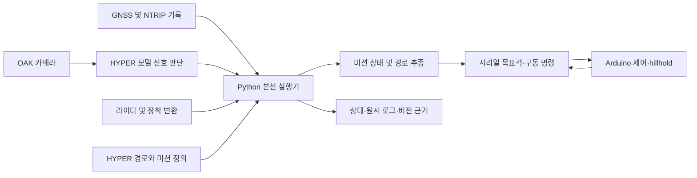

# 실제 구성과 재사용 범위

원격 초기 README의 ROS2·RealSense·센서 융합 계획을 최종 구현으로 표시하지 않는다. 본선 진입점은 Python 실행기와 Arduino 제어 보드다. HYPER의 ROS2 프로젝트 전체를 그대로 실행했다는 뜻도 아니다.

| 영역 | 구현 경로 | 설명 |
|---|---|---|
| 출발·운영 | `tools/main_event_start_left.py`, `main_event_menu.py`, `main_event.py` | L 자동 준비, 명시적 출발, 상태·선택·종료·복구 |
| 통합 실행 | `tools/main_event_runtime.py` | 센서 수신, 보드 통신, 미션·추종·로그 연결 |
| 경로 추종 | `tools/qualifier_follow.py`, `live_path_follow.py` | Pure Pursuit 계열 추종, heading, 진행 방향·진입 선택·lookahead |
| 미션 | `tools/main_event_core.py`, `main_event_sequence.py`, `main_event_plan.py` | 경사·신호·S·주차·전후진·종점 연결 |
| 보조 센서/회복 | `tools/main_event_degraded.py` | 비필수 센서와 READY 분리, 정지 상태 GPS 연속성 재확인, 사전 선택 |
| 인지 | `tools/main_event_signal.py`, `hyper_signal_offline.py` | 기존 HYPER 모델·크롭·시각/목표/프레임 검증 |
| 라이다 | `tools/main_event_lidar_scope.py`, 장착 설정 | 현재 미션 진로와 관측 상태, 상하 반전 장착 구분 |
| 저수준 제어 | `tools/steer_target_host.py`, `main_event_serial.py`, `firmware/` | 요청·부팅 식별, 분할 프레임, 목표각·구동·정지·버티기 |
| 기록 | `tools/dev_run_log.py`, `data/`, `logs/development/` | 명령·종료코드·해시·실제 수신·송신·영상 |

## 재사용과 자체 작업

- HYPER: 기존 경로·미션 정보·신호 모델과 구조를 참고/재사용했다. 출처는 로컬 HYPER README에 명시된 `https://github.com/qndks11/HYPER`이며, 사용 파일과 해시는 최종 manifest에 있다.
- 차량별 작업: 조향 보정·D50 정합, 단일 보드 제어, GPS heading/진입/추종, hillhold 연결, 미션 통합, CLI, 통신 복구, 기록·검사.
- 학습 모델을 새로 완성한 프로젝트로 소개하지 않는다. light_1 저장 사진 평가와 다른 조명·light_2/3 실제 주행 검증을 구분한다.
- 주차 표지는 사진/분류 자료가 존재하는 것과 실제 차량 소비 경로에 통합돼 주차한 것이 다르다. 최종판은 현장 사전 선택을 사용했다.

## 차량별 제약

직진477, DIR50, 좌25°/우19°는 당시 운용 기록이다. 다른 차량에서 그대로 사용할 보편적인 값이 아니다. 라이다 장착 변경 전 기록에 새 반전 변환을 덮어씌우지 않았다. 속도PWM은 m/s가 아니며, 목표100·실제 전송100·실차 속도/정지거리 검증을 구분한다.

USB-C5G는 인터넷·NTRIP 경로다. 인터넷 보정 복구가 GPS FIX나 heading을 자동 보장하지 않는다. 정지 READY 성공은 구동 중 처리 지연이나 미션 재개 검증을 대신하지 않는다.
